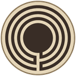
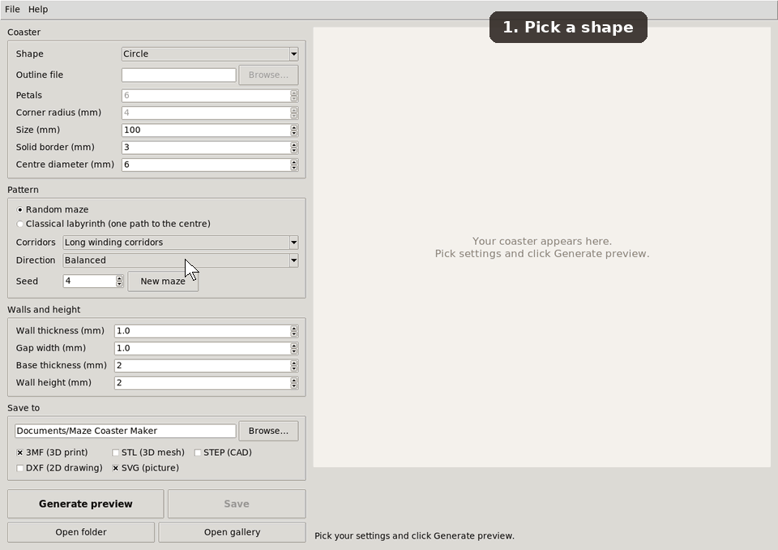
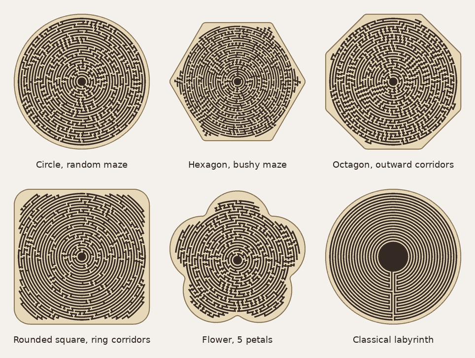
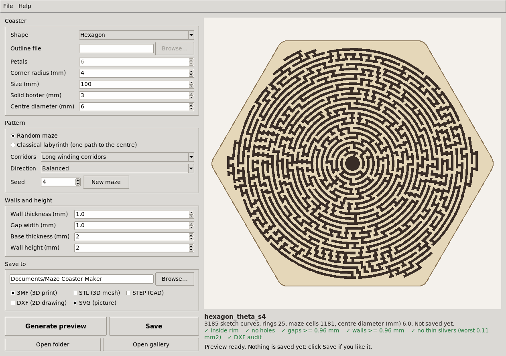
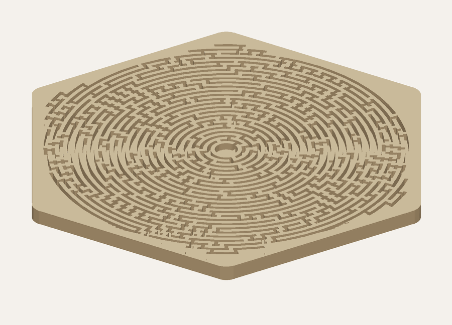
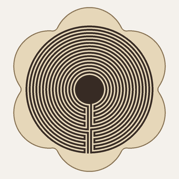
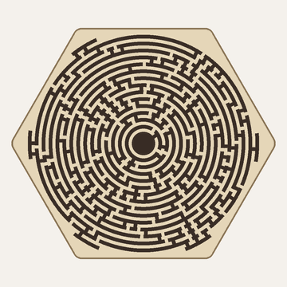
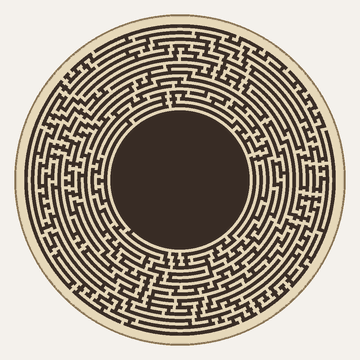

#  Maze Coaster Maker

[](https://ko-fi.com/corautem) [](https://github.com/sponsors/corautem)

A desktop app for Windows, macOS and Linux that makes coasters with a circular maze for 3D printing. Pick a shape and a pattern, preview the maze, and save a 3MF file that opens straight in your slicer.



## Features

- **Random mazes or a classical labyrinth:** a new random maze for every seed, or the traditional single path to the centre.
- **Six outlines:** circle, hexagon, octagon, rounded square, flower with 3 to 24 petals, or your own outline from a DXF file.
- **Every size adjustable:** coaster size, border, centre, wall thickness, gap width, base thickness and wall height, in millimetres.
- **Checked before you print:** each preview tests that every wall and gap is at least the width you set and that the maze stays inside the border.
- **Files for printing and CAD:** 3MF and STL for slicers, STEP as an editable solid for FreeCAD, Fusion or Onshape, DXF as a 2D drawing, and SVG as a picture.

It started as a way to make maze coasters with exact 1 mm walls and gaps without drawing each maze by hand in CAD. Version 2.0.0 is the first public release.

## Shapes and patterns



| Setting | Choices |
|---|---|
| Shape | Circle, hexagon, octagon, rounded square, flower, or a custom outline |
| Pattern | Random maze, or classical labyrinth |
| Corridors (random maze) | Long winding corridors, or bushy with many short dead ends |
| Direction (random maze) | Balanced, around the rings, or outward |

## Installing

Download the file for your computer from the [Releases page](https://github.com/corautem/maze-coaster-maker/releases):

| Computer | File | First start |
|---|---|---|
| Windows | `…-windows-x64.exe` | Double-click it. If Windows shows "Windows protected your PC", click **More info**, then **Run anyway**. |
| Mac with Apple silicon or Intel | `…-macos-arm64.zip` or `…-macos-x64.zip` | Unzip it and drag **Maze Coaster Maker** into Applications. If macOS blocks it, open **System Settings → Privacy & Security** and click **Open Anyway**. |
| Linux, x64 or ARM | `…-linux-x64.tar.gz` or `…-linux-arm64.tar.gz` | Unpack it and run `MazeCoasterMaker`. |

<details>
<summary>Running from the source code instead</summary>

With Python 3.10 or newer:

```
pip install -r requirements.txt
python coaster_app.py
```

On Linux, Python's Tk support may be a separate package, such as `python3-tk` on Debian and Ubuntu. [Development](docs/development.md) covers building the app yourself.

</details>

## Getting started

1. Pick a **shape** and a **pattern**.
2. Click **Generate preview**. The checks under the preview should all show ✓.
3. Click **New maze** until you like it.
4. Tick **3MF** and click **Save**. The file goes to `Maze Coaster Maker` in your Documents folder.
5. Open the 3MF in your slicer, such as PrusaSlicer, Bambu Studio, OrcaSlicer or Cura, and print.



## Using it

- **Wall thickness and gap width** set the maze; 1 mm each prints well with a 0.4 mm nozzle.
- **Base thickness and wall height** set the 3D model; the coaster is base plus wall height thick, 4 mm by default.
- **Save** writes the ticked files, and asks before replacing any. **Open gallery** shows every saved design side by side.
- **Help → What the settings do** explains each setting in the app.



## Examples

<details>
<summary><b>A flower with a classical labyrinth</b></summary>

Shape **Flower**, pattern **Classical labyrinth**, everything else as it starts.



</details>

<details>
<summary><b>Wider walls for a 0.6 mm nozzle</b></summary>

Shape **Hexagon**, wall thickness **1.5**, gap width **1.5**.



</details>

<details>
<summary><b>A large centre for a logo or a name</b></summary>

Shape **Circle**, centre diameter **40**. Add the logo or name afterwards in a CAD program, from the STEP file.



</details>

## Troubleshooting

- **A check shows ✗:** try another seed with **New maze**, or a wider wall or gap.
- **The centre is bigger than I set:** the rings come in fixed steps; the note under the preview gives the size it used.
- **The app takes a few seconds to open:** the Windows and Linux versions unpack themselves at each start.
- **A STEP file is slow to open in CAD:** dense mazes make large files. In testing with OpenCascade, the geometry engine in FreeCAD, a 100 mm coaster with the default settings opened in about 3 seconds, and 150 mm coasters with 0.8 mm gaps in 11 to 17.

## Documentation

- [Settings](docs/settings.md): every setting, with its range and default.
- [Files](docs/file-formats.md): what each saved file holds, and which program opens it.
- [Command line](docs/command-line.md): making coasters from a terminal with `coaster_gen.py`.
- [Development](docs/development.md): running from source, building the app, and releasing a version.

## Support

If Maze Coaster Maker is useful to you, a star on GitHub (the Star button at the top of this page) helps other people find it. If you'd like to support the work, you can do so through [GitHub Sponsors](https://github.com/sponsors/corautem) or on [Ko-fi](https://ko-fi.com/corautem).

- **Bugs and ideas:** [GitHub issues](https://github.com/corautem/maze-coaster-maker/issues), with a form for each.
- **Questions:** also in [GitHub issues](https://github.com/corautem/maze-coaster-maker/issues/new/choose), with the Question form.

## Licence

Maze Coaster Maker is free software under the [GNU General Public License, version 3 or later](LICENSE). Copyright (C) 2026 corautem.

The app is built with Python, Tcl/Tk, shapely (with GEOS), numpy, ezdxf and other open-source packages, each under its own licence. The app lists them under **Help → Third-party licences**, and [THIRD-PARTY-NOTICES.md](THIRD-PARTY-NOTICES.md) does the same here.
