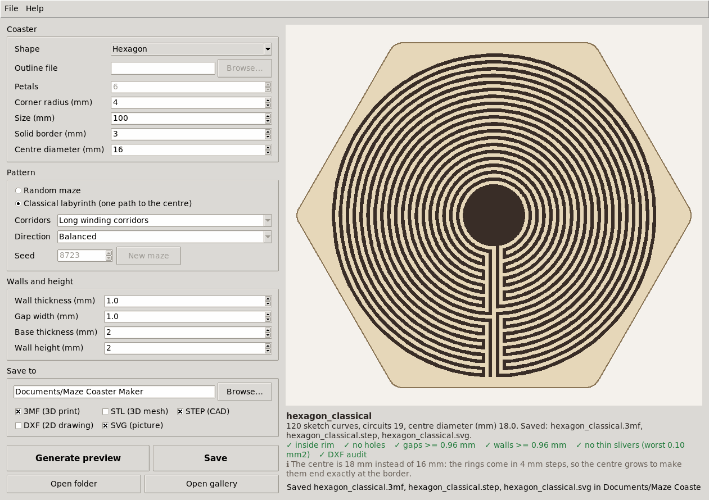
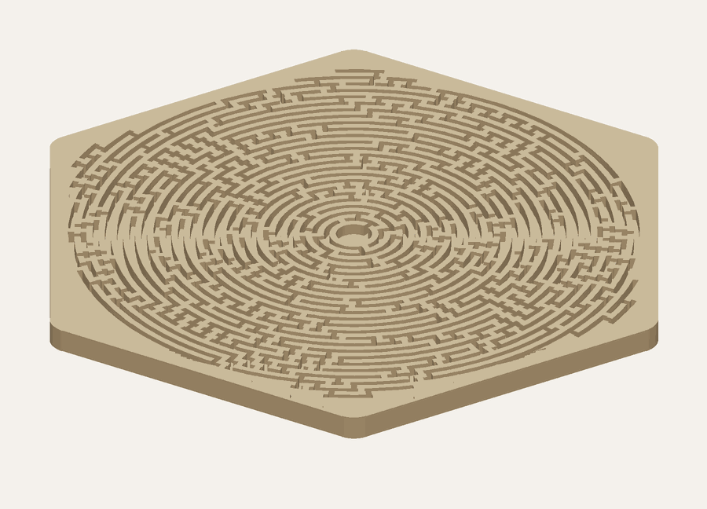

# Files

**Save** writes one file per ticked type, all in millimetres. The 3D files are checked before they are written: if a model doesn't close up into one solid, that file isn't written and a message says so.

| File | For | Opens in |
|---|---|---|
| 3MF | printing | Slicers such as PrusaSlicer, Bambu Studio, OrcaSlicer and Cura |
| STL | printing, and 3D programs that don't read 3MF | Slicers, Blender, Tinkercad and most 3D programs |
| STEP | editing the coaster as a solid | CAD programs such as FreeCAD, Fusion and Onshape |
| DXF | the 2D drawing | CAD and laser-cutting programs |
| SVG | a picture of the design | Web browsers; **Open gallery** shows all of them |

## 3MF and STL

The finished 3D model as a mesh of triangles: a solid base with the maze walls standing on it.

- The base runs from 0 to the base thickness, and the walls up to base plus wall height.
- The model's corner sits at 0, 0, 0, so it lands on the slicer's bed.
- Curves are made of short straight pieces that stay within 0.005 mm of the true curve on a 100 mm coaster.
- STL holds the same mesh as the 3MF, in binary STL.

## STEP

An exact solid: every face is flat or part of an upright cylinder, and every edge a straight line or an arc, so CAD programs open it as a body that can be edited, for example to add a name, a logo or a recess for a cork pad.

- The coaster is centred on 0, 0, as in the DXF, with the base starting at 0.
- The large flat faces, the tops of the walls and the floors of the channels, are cut into strips. A face whose outline has thousands of edges takes CAD programs much longer to open: in testing with OpenCascade, the geometry engine in FreeCAD, cutting them into strips brought a 100 mm coaster from 74 seconds down to 3.
- The files are tested by reading them back with OpenCascade: each was one valid solid with the same volume as the 3MF, to within 0.02 %.

## DXF

The flat drawing in two layers:

- `OUTLINE`: the coaster's outer edge.
- `CHANNELS`: closed loops around the gaps between the walls.

Everything inside the outline that isn't a channel is wall or rim. In a CAD program, extrude the outline to the full height, then cut the channels down to the base.

## SVG

A picture of the design from above, in the app's colours. Each save with SVG ticked also updates `index.html` in the folder, which **Open gallery** opens to show every saved design side by side.

## File names

A file is named after its shape, pattern and seed, such as `hexagon_theta_s4`. Settings that differ from the defaults are added:

| Part | Means |
|---|---|
| `120mm` | size 120 mm |
| `w1.5-g1.5-r3` | wall 1.5 mm, gap 1.5 mm, border 3 mm |
| `c40` | centre diameter 40 mm |
| `b1.6-h3` | base 1.6 mm, wall height 3 mm |
| `prim`, `ring`, `radial` | bushy corridors, around the rings, outward |

So the file name records the settings that made the coaster, apart from a changed corner radius.
