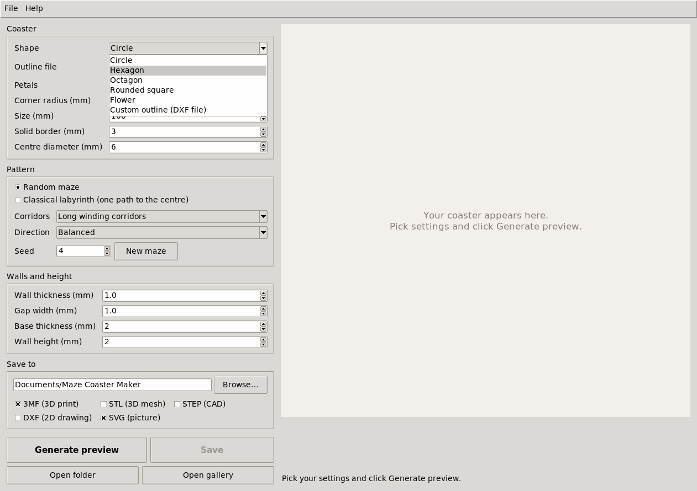

# Settings

Every setting in the app, with what it does, its default and the values it accepts. **Help → What the settings do** gives the same explanations inside the app. For the same settings on the command line, see [Command line](command-line.md).

## Coaster

| Setting | Default | Accepts | What it does |
|---|---|---|---|
| Shape | Circle | Circle, Hexagon, Octagon, Rounded square, Flower, Custom outline | The coaster's outline. |
| Outline file | | a DXF file | Custom outline only: the largest closed shape in the file, drawn in millimetres. The maze is centred on the roomiest point inside it. |
| Petals | 6 | 3 to 24 | Flower only: the number of petals. |
| Corner radius (mm) | 4 for hexagon and octagon, 12 for rounded square | 0 to 150 | How round the corners are. |
| Size (mm) | 100 | 20 to 300 | The overall width, measured across the flat sides for polygons. |
| Solid border (mm) | 3 | 0.4 to 50, and at least the wall thickness | The plain rim between the outline and the maze. |
| Centre diameter (mm) | 6 for a random maze, 16 for a classical labyrinth | 1 to 250 | The round goal in the middle. The rings come in steps of wall plus gap, so the centre grows by up to two steps until the outer ring meets the border; a note under the preview gives the size used. A warning says when the centre can't be as small as you set. |

## Pattern

| Setting | Default | Accepts | What it does |
|---|---|---|---|
| Pattern | Random maze | Random maze, Classical labyrinth | A random maze is new for every seed. A classical labyrinth is a single path to the centre with no dead ends; in a non-round shape it sits in the largest circle that fits. |
| Corridors | Long winding corridors | Long winding corridors, Bushy | Random maze only. Bushy mazes have many short dead ends. |
| Direction | Balanced | Balanced, Around the rings, Outward | Random maze only. Around the rings gives long curved runs, outward more corridors from the centre to the edge. |
| Seed | a random number | 0 to 9999 in the box | Random maze only. The same seed and settings always give the same maze; **New maze** picks a new seed and makes a preview. |

## Walls and height

| Setting | Default | Accepts | What it does |
|---|---|---|---|
| Wall thickness (mm) | 1.0 | 0.4 to 10 | The width of each maze wall. 1 mm prints as two lines with a 0.4 mm nozzle. |
| Gap width (mm) | 1.0 | 0.4 to 10 | The width of each channel between walls. |
| Base thickness (mm) | 2 | 0.2 to 20 | The solid floor under the maze. For walls in a second colour, add a filament change in your slicer at this height. |
| Wall height (mm) | 2 | 0.2 to 50 | How far the walls stand above the floor. The coaster is base plus wall height thick. |

## Save to

| Setting | Default | What it does |
|---|---|---|
| Folder | `Maze Coaster Maker` in your Documents folder | Where **Save** writes the files. |
| File types | 3MF and SVG ticked | Which files **Save** writes. [Files](file-formats.md) describes each one. |

## Checks under the preview

Each preview runs these checks before you save:

- **inside rim:** no channel reaches into the solid border.
- **no holes:** every wall connects to the rest; none stands on its own inside a channel.
- **gaps** and **walls:** every gap and wall is at least the width set, less a 0.04 mm tolerance.
- **no thin slivers:** no scrap of wall or gap too small to print.
- **DXF audit:** the drawing has no errors.

## Where the app keeps its settings

The app remembers your settings between starts, in:

- Windows: `%APPDATA%\Maze Coaster Maker`
- macOS: `~/Library/Application Support/Maze Coaster Maker`
- Linux: `~/.config/maze-coaster-maker`

Delete that folder to go back to the defaults.
